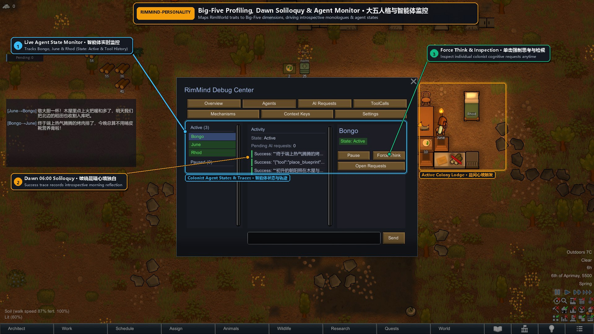
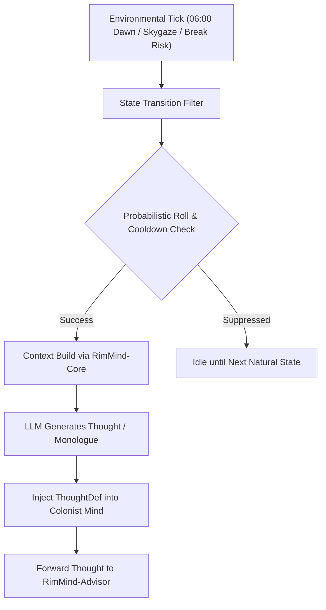

<div align="center">

# RimMind-Personality 🎭
### LLM Psychological Profiles, Dynamic Mood Thoughts & Probabilistic Reflections for RimWorld 1.6 & 1.7

**English** | [简体中文](README_zh.md)

<p>
  <a href="https://rimworldgame.com/"></a>
  <a href="https://github.com/RimWorld-RimMind-Mod/RimWorld-RimMind-Mod-Core"></a>
  <a href="#"></a>
  <a href="LICENSE"></a>
</p>

<p><em>Infuse colonists with persistent inner narratives, evolving agent identities, and organic mood reflections.</em></p>

</div>

---

## 📖 Overview

**RimMind-Personality** builds a persistent LLM-driven psychological profile and structured `AgentIdentity` (motivations, traits, core values) for every colonist. Combining **probabilistic state-transition triggers**, major life events, and staggered daily evaluations, colonists continuously interpret their colony life and materialize 1 to 3 dynamic mood Thoughts.

### Key Highlights
- **Persistent Psychological Profiles & Agent Identity**: Synthesizes an evolving AI narrative plus structured motivations, traits, and core values grounded in each colonist's vanilla traits, memories, and player customizations in the Bio tab.
- **Probabilistic State-Transition & Event Triggers**: Colonists reflect organically during meaningful moments:
  - 🌅 **Sunrise (06:00 Dawn)**: Morning reflection as daylight returns (default chance: 30%).
  - 🌌 **Skygazing / Solitude**: Quiet philosophical or introspective musings (default chance: 40%).
  - 🍷 **Shared Recreation**: Reflections sparked during leisure activities (default chance: 25%).
  - 💔 **Traumatic Mood Swings & Colony Events**: Sharp mood shifts (default chance: 50%), severe injuries, skill milestones, major threat incidents, and companion bereavement.
- **3-Slot Dynamic Thought Injection & Shape Voting**: Injects up to 3 independent `Thought_AIPersonality` entries (intensity `-3..+3`, mood offset `-10..+10`) and lets players reinforce, suppress, or edit personality traits via Bio tab Shape Voting.

---

## 🎮 In-Game Showcase


*Live Agent State Monitor & Dawn 06:00 Soliloquy: Tracking active colonist agents (`Bongo`, `June`, `Rhod`), one-click `Force Think` diagnostics, and introspective morning soliloquy traces alongside the active colony lodge.*

---

## 🏛️ Architecture & State-Transition Pipeline



---

## 🛠️ Installation & Load Order

```text
1. Harmony
2. Core (Vanilla RimWorld)
3. RimMind-Core
4. RimMind-Personality
```

---

## 🧪 Developer Guide & Testing

Run unit tests directly:

```powershell
dotnet test RimMind-Personality/Tests/RimMindPersonality.Tests.csproj -c Release
```

---

## 📜 License

Licensed under the [MIT License](LICENSE).
