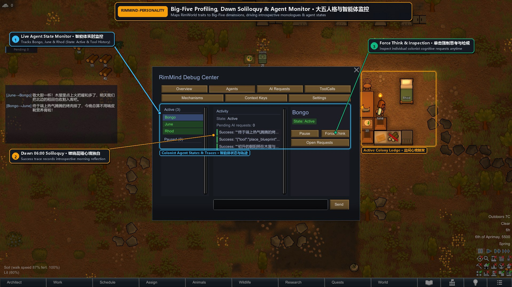
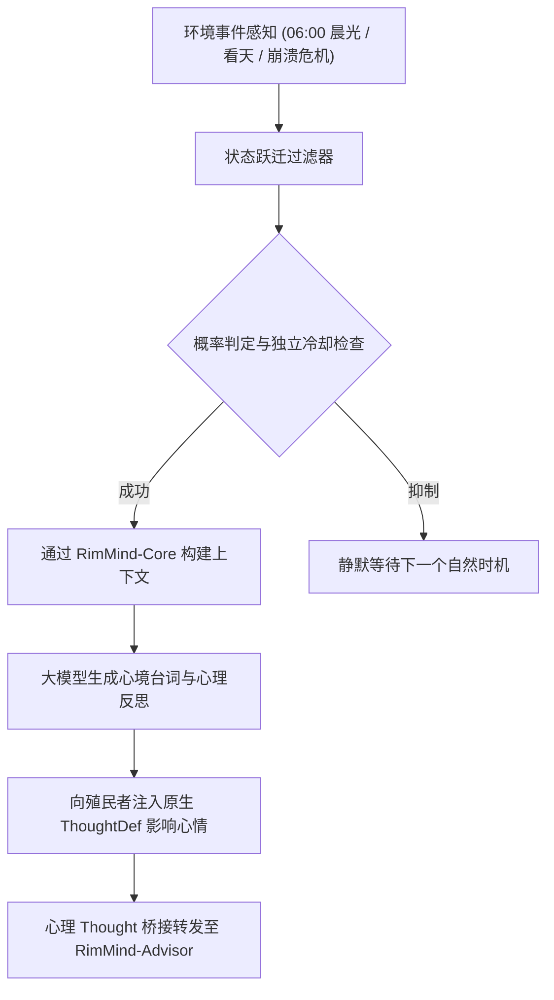

<div align="center">

# RimMind-Personality 🎭
### 专为 RimWorld 1.6 & 1.7 打造的 LLM 心理档案、动态心境 Thought 与概率反思系统

[English](README.md) | **简体中文**

<p>
  <a href="https://rimworldgame.com/"></a>
  <a href="https://github.com/RimWorld-RimMind-Mod/RimWorld-RimMind-Mod-Core"></a>
  <a href="#"></a>
  <a href="LICENSE"></a>
</p>

<p><em>为殖民者赋予持续演化的内在心理档案、智能体身份画像与随境而生的动态心情 Thought。</em></p>

</div>

---

## 📖 模块概览

**RimMind-Personality** 为每位殖民者构建由大模型驱动的持久化心理档案与结构化 `AgentIdentity`（动机、特质与核心价值观）。它结合**基于概率的状态跃迁触发**、重大人生事件与每日交错评估，让小人持续消化殖民地经历并生成 1 至 3 条动态心境 Thought。

### 核心特性
- **持久化心理档案与智能体身份**：结合原版特质、殖民地记忆与玩家在 Bio 页的自定义设定，持续演化 AI 心理叙事与动机/特质/价值观画像。
- **概率状态跃迁与事件触发体系**：在富有意义的自然情境与重大变故时触发反思：
  - 🌅 **破晓晨曦 (06:00)**：清晨微光洒下时的内心独白（默认概率 30%）。
  - 🌌 **仰望星空 / 独处**：户外看天或静思时的哲学与诗意遐思（默认概率 40%）。
  - 🍷 **娱乐休憩**：休闲活动中的心境流露（默认概率 25%）。
  - 💔 **心态剧变与重大事件**：剧烈情绪波动（默认概率 50%）、严重负伤、技能突破、重大威胁袭击与挚友离世。
- **三槽位动态 Thought 与玩家塑造投票**：最多独立注入 3 个 `Thought_AIPersonality` 槽位（强度 `-3..+3`，映射 `-10..+10` 心情偏移），支持在 Bio 页通过塑造投票强化或抑制 AI 性格判断。

---

## 🎮 实机特性展示


*智能体状态监控与晨曦独白实机：在 F8 `Agents` 面板实时追踪 `Bongo`、`June`、`Rhod` 的活跃认知状态、单击 `Force Think` 强制思考，并检视破晓晨曦触发的内省独白记录。*

---

## 🏛️ 系统架构与状态跃迁管道



---

## 🛠️ 安装与加载顺序

```text
1. Harmony
2. Core (RimWorld 原版)
3. RimMind-Core
4. RimMind-Personality
```

---

## 🧪 开发者测试指南

运行单元测试：

```powershell
dotnet test RimMind-Personality/Tests/RimMindPersonality.Tests.csproj -c Release
```

---

## 📜 开源协议

本项目采用 [MIT License](LICENSE) 开源许可证。
